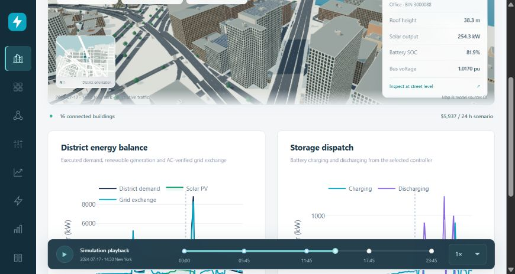
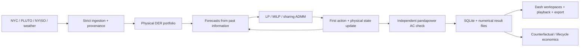

# New York Virtual Power Plant Control Centre

A Python engineering laboratory that connects **real Brooklyn building geometry** to physical DER models, predictive control, synthetic distribution networks and independently verified AC power flow.

The application calculates its results. It does not use predetermined savings, decorative optimiser outputs or simulated utility telemetry. **This is a research simulator, not a utility control system.**

**[Public GitHub repository](https://github.com/BehnamMohseniGharyehsafa/nyc-virtual-power-plant-control-centre)**



[Watch the moving district preview (WebM)](docs/images/district-demo.webm) · [Street-level façade detail](docs/images/street-view.png)

The spatial command centre includes detailed windowed façades, real NYC streets and waterfront geometry, rooftop equipment and PV, street furniture, and 64 vehicles following a stored illustrative Python traffic scenario. Explore district, street-level and plan views, change lighting, inspect buildings, and enable calculated electrical flows. Architectural details are estimated; traffic is illustrative. [Urban visualisation and provenance](docs/urban-visualisation.md).

## Run locally

Supported: Python **3.12–3.13**. Development and numerical validation were performed with Python 3.13.15 on Windows. All default solvers are open source.

```powershell
python -m venv .venv
.\.venv\Scripts\Activate.ps1
python -m pip install -e ".[dev]"
python -m data.download --date 2024-07-17 --buildings 1000
python -m data.urban
python -m app.main
```

On Linux/macOS, activate with `source .venv/bin/activate`. Open **http://127.0.0.1:8050**. The initial 16-building, 96-step MPC run executes in a background worker. Progress, cancellation and previously completed results remain available. Subsequent launches restore persisted results.

No API key is needed for the bundled NYC, NYISO and Open-Meteo acquisition routes. Internet access is required for installation and acquisition; numerical simulation and footprint visualisation then work offline. Missing inputs cause a visible error, not a synthetic replacement. Cached local snapshots are included for immediate local use; see [data rights and provenance](docs/data.md) before redistributing data separately.

For the exact tested dependency set, install with `python -m pip install -r requirements-validated.txt` before `python -m pip install -e .`. The validated environment passes all 33 tests, including the numerical foundation and urban scene checks, and reproduced the 96-step community experiment with no reported physical violations.

```powershell
python -m pytest
python -m experiments.run --config scenarios/community.json --export
python -m experiments.run --config scenarios/infeasible.json
python -m experiments.benchmark --sizes 16 64 500 1000 --steps 4 --horizon 4
python -m experiments.sizing --buildings 16 --steps 96 --horizon 96
```

The deliberately infeasible example exits with status 1 and preserves failure diagnostics. Results are written to `results/<UUID>/` and indexed in SQLite. The application also exports a ZIP containing CSV, Parquet, GeoJSON, scenario/provenance JSON, solver diagnostics, AC-network results and PNG/SVG figures.

## What works

| Capability | Implementation and boundary |
|---|---|
| Geographic district | 1,000 observed NYC footprints, projected-area calculation, observed/assumed roof heights, exact normalised BBL join to PLUTO; many buildings may share a lot |
| Solar PV | pvlib solar position, POA transposition, Faiman module temperature, PVWatts DC and inverter conversion, clipping and controllable curtailment |
| Battery storage | Separate charge/discharge powers, 95% directional efficiencies, 10–90% SOC, power bounds, terminal energy, throughput wear cost and outage scenario |
| Buildings / HVAC | Assumed archetype demand schedules, one-state RC dynamics with exact zero-order-hold discretisation, temperature-dependent illustrative COP, explicit comfort limits |
| EV charging | Assumed workplace arrival/departure schedule, charger limits, efficiency, cumulative delivered energy and departure requirements; V2G disabled |
| Electrical network | Synthetic 69/13.8/0.4 kV network, individual building transformers, radial operation; meshed ties for local simulations and snapshot AC OPF |
| Multi-period dispatch | Sparse LinDistFlow, active/reactive coupling, conservative inscribed-octagon thermal limits, intertemporal devices; HiGHS LP/MILP |
| AC verification / OPF | pandapower AC verification at every executed step; separate snapshot nonconvex AC OPF for PV/reactive dispatch, followed by independent power flow |
| Controllers | Conventional local, rule based, economic MPC, network-aware MPC; convex sharing ADMM with local P/Q copies and recorded residuals |
| Forecasting | Strictly historical weather persistence/day-lag forecasts; known assumed retail TOU; completed-interval price persistence for wholesale scenarios |
| Flexibility | Signed events, explicit counterfactual, requested/delivered response, recovery, hypothetical all-interval settlement; multi-period sustained envelopes with binary modes and AC checks |
| Economics | Distinct retail/wholesale settlement, window demand charge, no-DER and local-control references, lifecycle cash flows, NPV/IRR/MIRR, discounted payback, seeded NPV scenarios, discrete sizing experiments |
| Interface | Nine workspaces, detailed real-footprint buildings with estimated façades/windows, observed streets and waterfront, modelled traffic, district/street/plan cameras, per-building numerical inspection, synchronous stored-state playback |

There are substantive limits. Roof PV suitability, thermal parameters, HVAC technology, EV availability and DER installations are **assumed**, not surveyed. Building use comes from tax-lot land use and is a **derived** building label. Annual benchmarking calibration is not implemented. The retail tariff is **illustrative**, not a quoted Con Edison service classification. No real market eligibility or revenue entitlement is asserted. See [known limitations](docs/limitations.md).

## District and sources

Study boundary: WGS84 **west −74.001, south 40.688, east −73.977, north 40.709**, covering DUMBO and Downtown Brooklyn. Smaller portfolios are selected by centroid distance from 40.703° N, 73.989° W. Spatial areas are calculated in **EPSG:32618**, not square degrees. Height is converted from source feet to metres.

Sources: [NYC OTI footprints](https://data.cityofnewyork.us/d/5zhs-2jue), [PLUTO](https://data.cityofnewyork.us/d/64uk-42ks), [NYISO day-ahead](https://mis.nyiso.com/public/P-2Alist.htm), [NYISO real-time](https://mis.nyiso.com/public/P-4Alist.htm), [Open-Meteo reanalysis](https://open-meteo.com/en/docs/historical-weather-api). The supplied footprint map ID `3g6p-4u5s` identifies `5zhs-2jue` as its underlying source. The downloader records that relationship.

The default historical day is **17 July 2024**. The building snapshot was downloaded in November 2026; it is not represented as a reconstruction of the 2024 building stock. Weather is gridded reanalysis, not measured rooftop weather. Source download times, hashes, transformations, units and missing-value policies accompany each run.

## Architecture



Physical equations are in `models/`, dispatch constraints in `optimisation/`, forecasts/controllers in `controllers/`, and receding-horizon execution in `core/`. Dash callbacks select configurations and present results; they do not contain the engineering equations. A single background worker avoids unnecessary microservices.

## Scientific interpretation

Convergence is not the same as physical feasibility or global optimality. Linear schedules are approximations. Nonlinear AC OPF is reported as locally converged, without a global-optimality claim. Every executed schedule is independently checked for voltage, line, transformer, PCC, SOC, comfort and EV constraints. Violations remain visible and disqualify financial investment results.

The 500/1,000-building scalability experiments use **four forecast and execution steps**. They do not demonstrate 24-hour, 96-step MPC at those scales. Run your intended horizon and hardware before drawing performance conclusions. See [validation and measured benchmarks](docs/validation.md).

Read [mathematical formulations and solver matrix](docs/formulations.md), [data pipeline](docs/data.md), [stage-by-stage implementation report](docs/stages.md), [checked references](docs/references.md), and [publication instructions](docs/publication.md).

Code: MIT. Source datasets retain their own terms. [Contributing](CONTRIBUTING.md) · [Citation](CITATION.cff).
