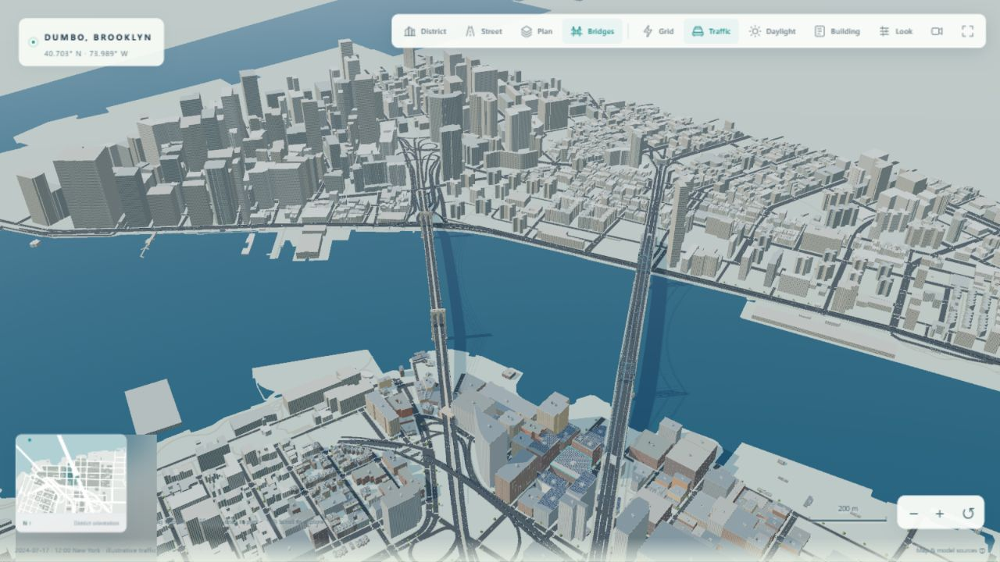
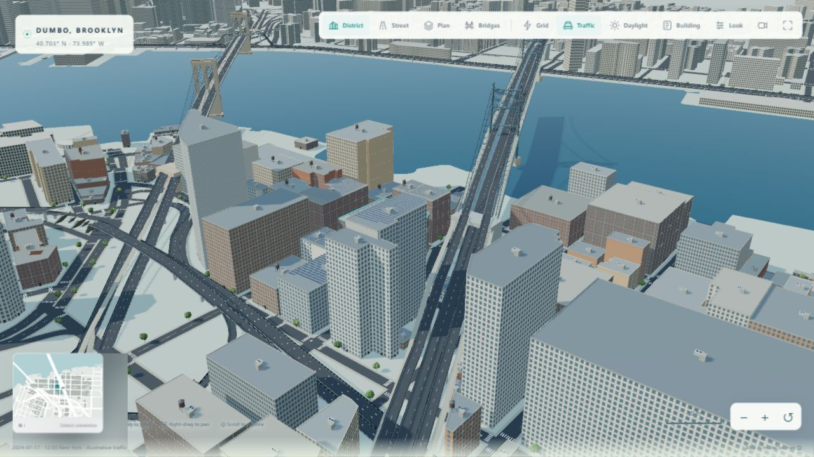
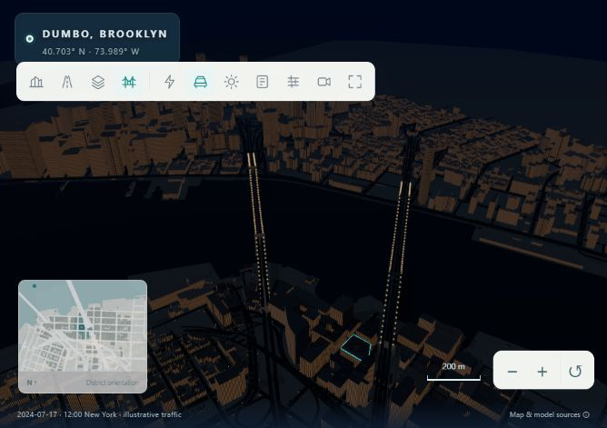

# Bridge and street continuity validation

Checked on 3 November 2026. The old 850 m selection and clipped geographic box omitted the Manhattan banks; elevated slabs and rails were generated on only every third polyline edge. The transport presentation now retains complete source segments and includes both bridge landings.

The Brooklyn Bridge has paired pointed masonry openings, four main cables, suspenders, diagonal stays, anchorages and a raised promenade. The Manhattan Bridge has steel lattice portals, four main cables and a separate lower rail deck and upper carriageways. Decks, edge girders and rails run continuously. Piers are not sprinkled through the navigable suspension span. Bridge approach elevations share source-node endpoints with connecting ramps; ground roads form unified asphalt, sidewalk and kerb surfaces at intersections. Tunnel, ferry and nonphysical links are excluded from surface streets.

**Observed versus estimated.** Horizontal carriageways, directions, widths, grade codes, footprints and available roof heights come from NYC OTI. The visual context is separate from the numerical portfolio. The DOT main spans are 1,595.5 ft (486.3084 m) and 1,470 ft (448.056 m). Tower stations are estimated along the observed alignment; vertical profiles, structural dimensions other than the stated source values, masonry detail, lights and furniture are presentation estimates. This is not a surveyed structural model. The street plane does not model local terrain elevation.

Primary references:

- [NYC Citywide Street Centerline](https://data.cityofnewyork.us/d/inkn-q76z), [official attribute definitions](https://github.com/CityOfNewYork/nyc-geo-metadata/blob/main/Metadata/Metadata_StreetCenterline.md).
- [NYC DOT Brooklyn Bridge](https://www.nyc.gov/html/dot/html/infrastructure/brooklyn-bridge.shtml), [Brooklyn Bridge HAER record](https://tile.loc.gov/storage-services/master/pnp/habshaer/ny/ny1200/ny1234/data/ny1234data.pdf).
- [NYC DOT Manhattan Bridge](https://www.nyc.gov/html/dot/html/infrastructure/manhattan-bridge.shtml), [Manhattan Bridge HAER record](https://tile.loc.gov/storage-services/master/pnp/habshaer/ny/ny0900/ny0980/data/ny0980data.pdf).
- [NYC planimetric hydrography](https://data.cityofnewyork.us/d/pjs3-c3z5), [NYC building footprints](https://data.cityofnewyork.us/d/5zhs-2jue). Acquisition dates, bounds and source response hashes are in `data/cache/provenance.json`.

## Visual checks

The **Bridges** camera (keyboard 4) frames both suspension crossings and the shore approaches. The district, street, plan, orbit and zoom controls remain available. Complete adjoining water bodies avoid rectangular river cuts when zooming out. Observed context envelopes fill the opposite bank without adding energy assets, detailed window meshes or rooftop props. Context is tiled and batched; filtered facade windows remain legible at a distance. Road paint uses two triangles rather than solid boxes.

The browser checks cover desktop and mobile camera controls, traffic pause/resume, street view, lighting and an absence of console errors. In-app Chromium / Intel UHD Graphics at 1280 × 720 CSS pixels, Auto/Balanced and a 1600 × 900 drawing buffer reported a sampled bridge overview of about 33 FPS, 264 draw calls and 652,747 triangles including active passes. These are short hardware-dependent samples, not a guaranteed frame rate. Full diagnostics are saved in [qa.json](images/bridges/qa.json).

## Regression checks

The 40-test suite passes locally. New checks require connected carriageways in both travel directions across both banks, preservation of all observed named bridge segments, identical elevations at shared source nodes, valid joined street polygons and complete carriageway coverage. The offline module import graph covers the new renderer. JavaScript syntax, Python runtime/import lint and whitespace checks pass. GitHub CI repeats the suite on Python 3.12 and 3.13 and checks the production Gunicorn entry point.

Scene and traffic responses now revalidate on reload; a versioned scene request also avoids previously cached incompatible geometry. Numerical inputs, saved demonstration bytes and the VPP energy/control equations are unchanged. Public provenance identifies the architectural estimates.
