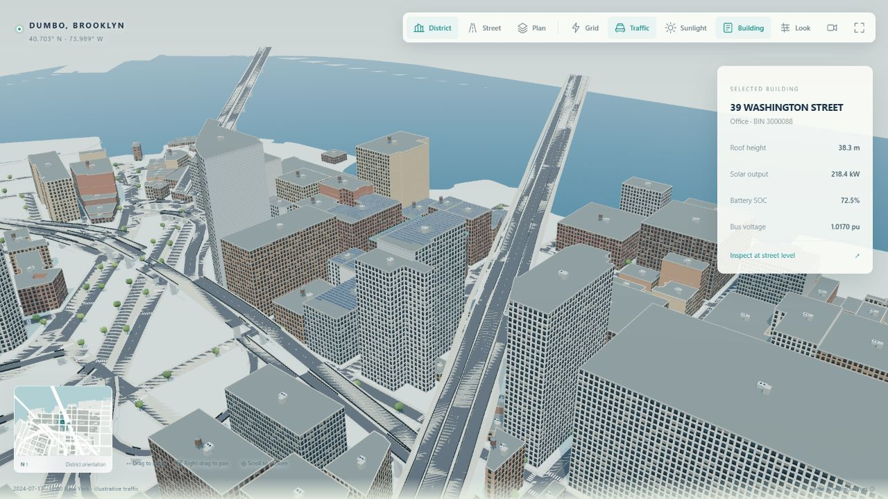
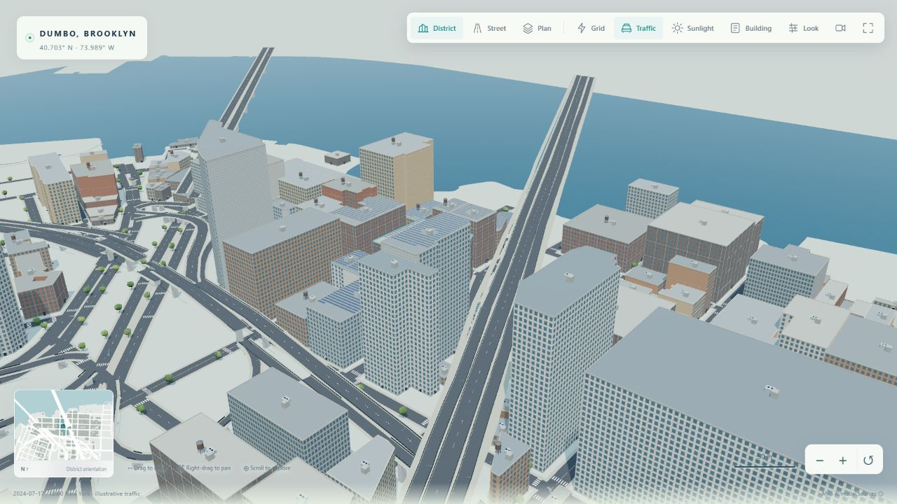
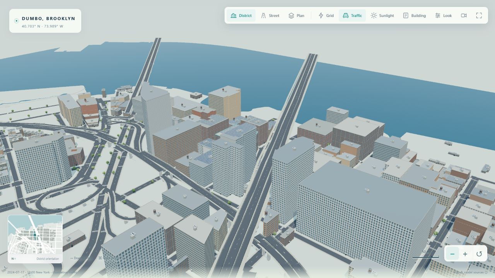
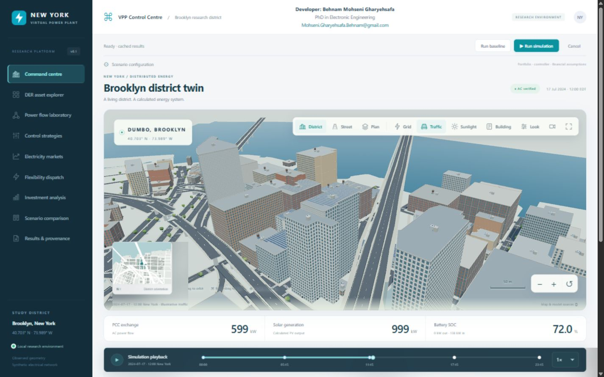
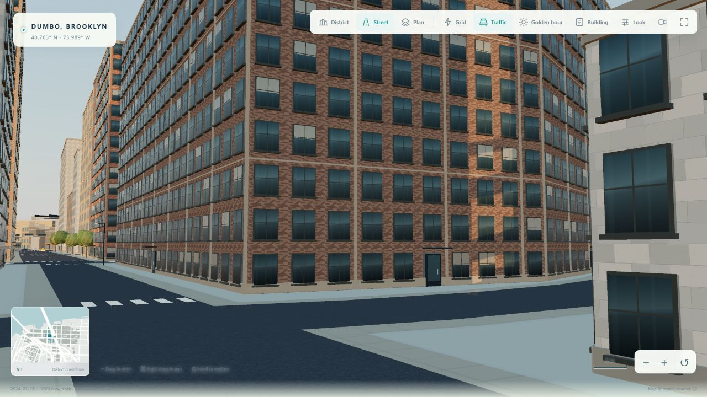

# District clarity and interaction checks

Checked on 3 November 2026 in the in-app Chromium browser on Windows, using Intel UHD Graphics through ANGLE. This update addresses distant-window aliasing and almost-coplanar street/water surfaces, then checks the close-up detail and workspace layout.

## Reproducible comparison

The previous renderer was read from commit `a64d6b3d9415705ba401af0cfe1638c3c7d8389e` and served alongside the changed renderer by a temporary local QA server. Both used the same saved run, camera, simulation lighting, **Balanced** quality, 1280 × 720 CSS viewport, device pixel ratio 1.5 and **1920 × 1080** drawing resolution. The other preview's traffic was paused before taking the comparison samples. No numerical simulation was re-executed for this visual comparison.

| Measured sample | Previous | Updated |
| --- | ---: | ---: |
| Drawn triangles, including active passes | 878,844 | 455,976 |
| Draw calls | 209 | 184 |
| Mean frame time | 54.0 ms | 37.8 ms |
| Measured frame rate | 18.5 FPS | 26.5 FPS |
| 95th-percentile frame interval | 86.7 ms | 65.6 ms |

The updated district sample draws about **48% fewer triangles**. Frame times are short browser samples, affected by GPU contention, driver state and timing; these are not a 60 FPS guarantee or a physical-device benchmark. Automatic quality can choose a lower-cost tier while retaining at least one drawing pixel per CSS pixel. The full sampled diagnostics are in [qa.json](images/clarity/qa.json).

The farther zoom check exposed water/terrain stripes in the previous depth setup. The updated near plane and explicit map-layer depth bias remove those visible stripes at the tested camera position, without changing geographic coordinates.

## Interaction and layout

Desktop, tablet and phone viewport checks cover the unobstructed canvas, cards below the district, centred developer credit and reachable camera controls. Zoom-out changes the camera distance from approximately 602 m to 770 m; street mode restores nearby geometric window detail. Lighting presets remain labelled presentation overrides. Traffic pause/resume, building inspection and night rendering are checked separately from the historical simulation playback.

## Software checks and limits

The 11 UI, urban-scene and hosting tests pass locally, including the transitive offline ES-module import graph. JavaScript syntax checks, Python formatting/linting and diff whitespace checks also pass. The protected-branch CI runs the complete numerical/software suite on Python 3.12 and 3.13, followed by the production Gunicorn entry-point check.

No physical phone, Firefox, Safari or external display was tested. Reduced-motion handling is retained but the OS preference was not changed during these checks. Window positions, roof dressing and traffic remain explicitly estimated/illustrative. The VPP calculations, saved data and geographic source geometry are unchanged.
