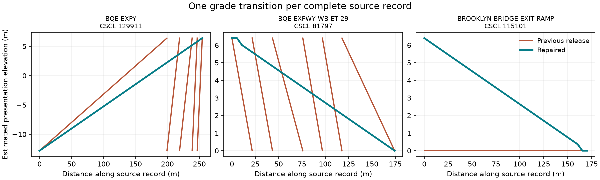
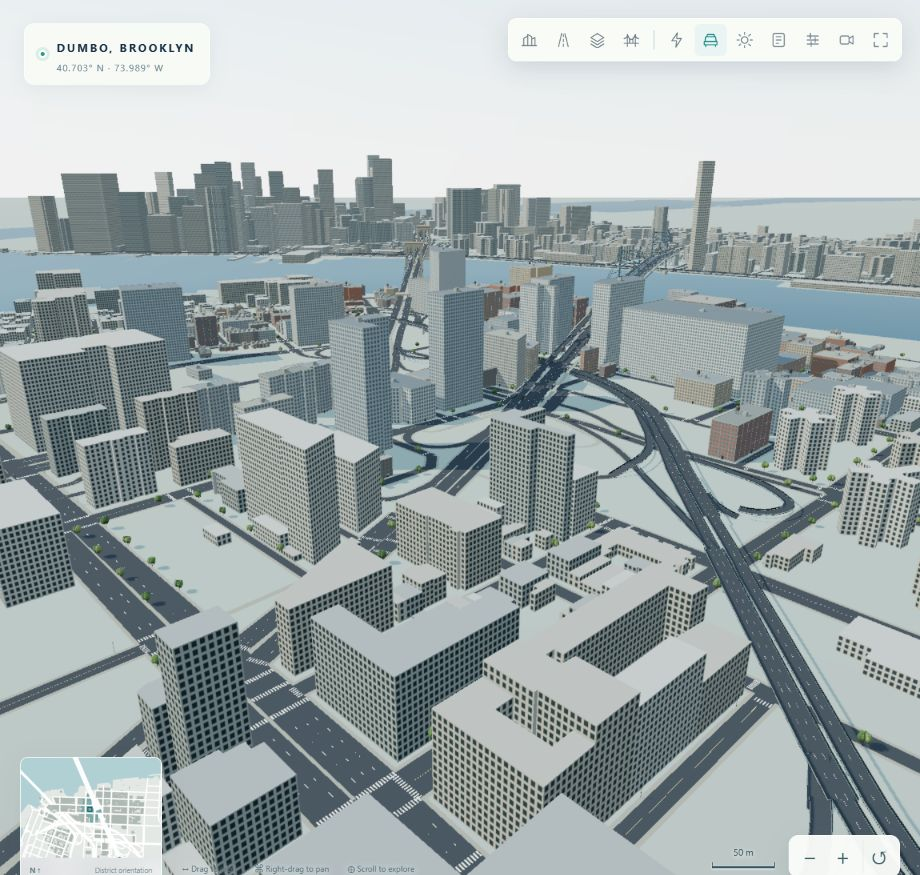
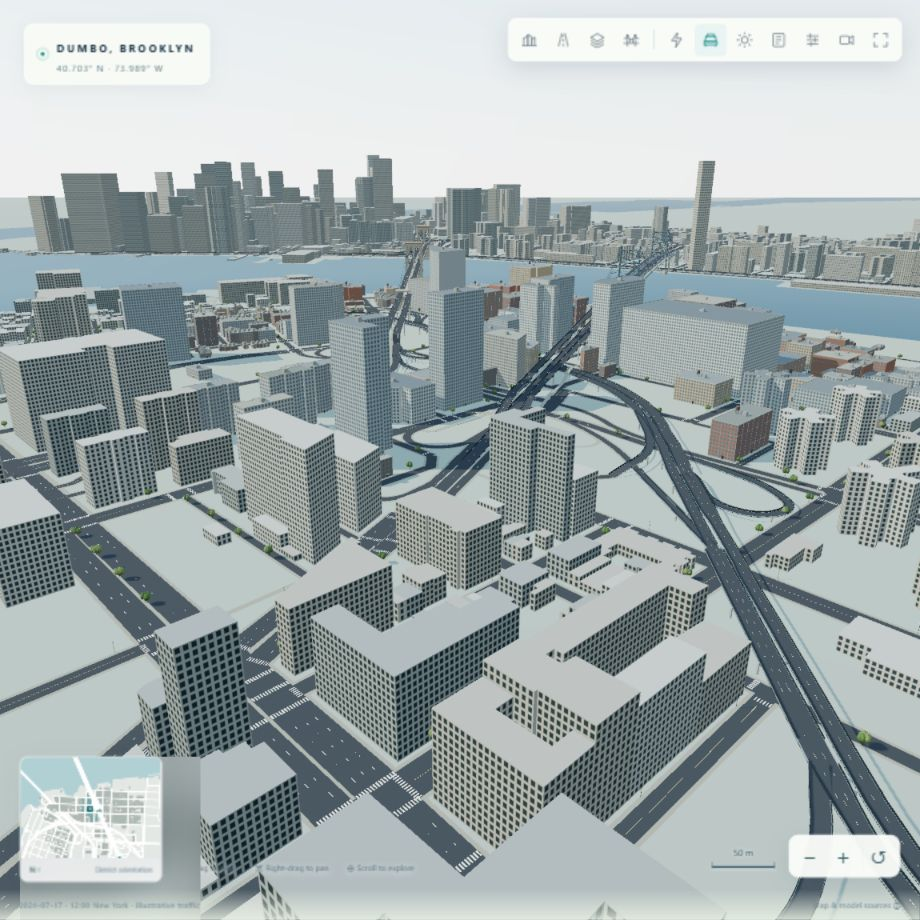
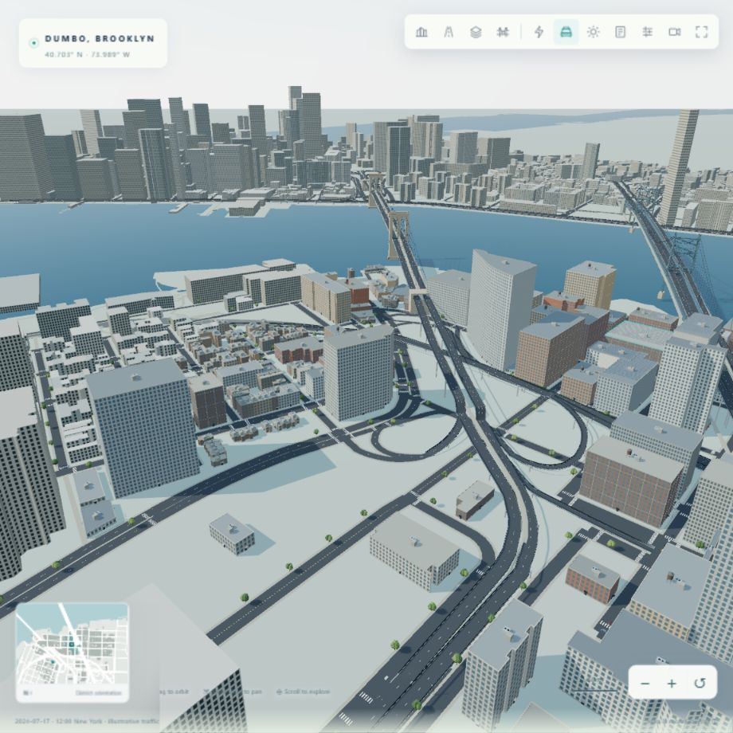

# Street and bridge-approach defect audit and repair

The audit starts from release `1f4592737957944620d9fb839aea315592063abc` and the supplied screenshot. Findings were checked against the cached NYC CSCL records, then independently rechecked by merging directed source chains, comparing internal heights, checking deck-edge cross-sections and reproducing the old renderer locally. The previous endpoint-code-only test missed internal multipart joins and did not test the rendered mesh.

## Confirmed defects before correction

| Defect | Exact scope and examples | Correction |
| --- | --- | --- |
| Connected storage parts treated as independent ramps | 114 physical multipart records; 15 have different from/to grade codes. There were 30 internal height resets in 9 source records. BQE `129911` reset its grade five times; `128674` was split into four ramps. | Merge connected parts with direction preserved; apply source endpoint codes once to the complete chain. |
| Suspension-span height formula used on inland approaches | The rule reached 133 approach/path records outside the actual span profile, including Brooklyn Bridge exit ramps and Manhattan Bridge approaches. Some happened to remain flat; others flattened elevated routes or produced negative humps. See the full source-by-source before/after heights in the inventory. | Apply the span profile to the actual spine and water-crossing paths; route ramps by chain distance and shared source nodes. At-grade chains stay at grade. |
| Ground concealed below-grade carriageways | Nine entire physical records were omitted; other BQE/FDR transition sections were covered by the flat ground plane. | Retain the observed roads and create three continuous open-cut regions with retaining walls and floor geometry. |
| Centre-lines met while deck edges did not | 62 raised-road endpoint pairs had cross-section mismatches over 0.25 m. The largest was 2.742 m at BQE exit `82607` / BQE `128674`. | Share both cross-section direction and width at joins. Loft inserted height samples from the existing cross-sections, keeping corner triangles from folding. Rails follow those continuous boundaries and remain open at merges. |

The [complete machine-readable inventory](transport-defects-before.json) lists every affected source ID, name, fragment count, height reset, omitted record and measured edge mismatch. Its approach-profile list describes the scope of the incorrect rule; it does not claim that every record produced a visible gap.

### All multipart grade-transition records

| CSCL object ID | Road/path name | Old storage parts | From/to codes |
| --- | --- | ---: | --- |
| `129911` | BROOKLYN QUEENS EXPY | 5 | 5 / 17 |
| `128674` | BROOKLYN QUEENS EXPY | 4 | 9 / 21 |
| `81797` | BROOKLYN QUEENS EXPWY WB ET 29 | 6 | 17 / 13 |
| `131433` | BROOKLYN BRG | 8 | 13 / 17 |
| `87160` | BROOKLYN QUEENS EP EB ET 29 B | 7 | 17 / 13 |
| `82402` | BQE WB ENTRANCE SANDS ST | 3 | 17 / 13 |
| `130469` | BROOKLYN QUEENS EP EB ET 28 B | 5 | 21 / 17 |
| `104190` | BROOKLYN BRIDGE PEDESTRIAN PATH | 3 | 13 / 17 |
| `61232` | BQE EB ENTRANCE TILLARY ST | 3 | 13 / 17 |
| `119112` | WILLIAMSBURG BRG | 3 | 13 / 17 |
| `71806` | BROOKLYN BRIDGE EXIT RAMP | 2 | 17 / 13 |
| `115101` | BROOKLYN BRIDGE EXIT RAMP | 8 | 17 / 13 |
| `112731` | MANHATTAN BRIDGE PEDESTRIAN PATH | 3 | 15 / 13 |
| `112730` | MANHATTAN BRIDGE PEDESTRIAN PATH | 3 | 15 / 13 |
| `103571` | MANHATTAN BRIDGE PEDESTRIAN PATH | 3 | 13 / 15 |

### All nine omitted physical records

| CSCL object ID | Road name | From/to codes |
| --- | --- | --- |
| `129657` | BROOKLYN QUEENS EXPY | 9 / 9 |
| `130177` | FDR DR  VIADUCT | 9 / 9 |
| `127773` | BROOKLYN QUEENS EXPY | 9 / 9 |
| `126550` | BROOKLYN QUEENS EXPY | 9 / 9 |
| `130121` | BROOKLYN QUEENS EXPY | 5 / 5 |
| `129057` | FDR DR  VIADUCT | 9 / 9 |
| `70310` | BQE WB ENTRANCE OLD FULTON ST | 5 / 9 |
| `126555` | BROOKLYN QUEENS EXPY | 5 / 5 |
| `128064` | BROOKLYN QUEENS EXPY | 5 / 5 |

## Matched visual recheck

The previous release and corrected renderer are served locally at identical fixed camera positions using the same saved energy run, daylight preset, 920 × 920 CSS viewport and Balanced quality. The Flatbush/Manhattan Bridge approach is checked separately from the Brooklyn Bridge interchange. These are geometry checks, not a frame-rate benchmark.

Useful reproducible camera query presets are `view=flatbush-approach`, `view=brooklyn-approach`, `view=manhattan-approach` and `view=brooklyn-cut`. They change presentation only. Browser diagnostics and console checks are in [qa.json](images/street-repair/qa.json).

## Verification and limits

All **43 tests** pass locally. The actual Three.js generator is also executed under Node in CI, rather than testing only the scene JSON. The final mesh check covers **724 road meshes**, **580 matched deck-edge comparisons** (pavement/slab layers), and **286 below-grade samples** ray-cast against the actual rendered ground mesh. It rejects inverted top triangles and seams larger than 3 mm, and confirms that the ground does not cover those below-grade samples. All 2,366 eligible physical transport records are retained, including the nine previously omitted records. Results: [transport-repair-validation.json](transport-repair-validation.json).

The source alignments, directions, widths and grade codes are observed. Codes describe relative grade, not surveyed heights in metres. Vertical profiles, retaining structures, bridge architectural details and support placement remain estimated presentation geometry. The numerical VPP equations, source data and saved demonstration bytes are unchanged. Moving cars remain an illustrative traffic scenario.

Primary references: [NYC CSCL dataset](https://data.cityofnewyork.us/d/inkn-q76z) and [NYC OTI attribute definitions](https://github.com/CityOfNewYork/nyc-geo-metadata/blob/main/Metadata/Metadata_StreetCenterline.md). The previous [bridge validation](bridge-street-validation.md) describes the bridge source dimensions and architecture assumptions.
